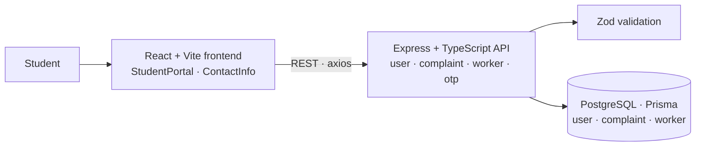

# Complaint_Portal

### Online complaint management for a college campus

      

Students used to file hostel and campus maintenance complaints on paper. This portal moves the whole process online for 5,000+ students: students raise and track complaints, workers are assigned, and admins see everything in one place.

## Features

- Student sign-in with **OTP verification**
- Raise complaints by category and track their status
- Workers are assigned to complaints and update progress
- Request validation with Zod on the backend

## Architecture



## Getting started

```bash
# Backend
cd Backend && npm install
npx prisma migrate dev
npx tsc && node dist/index.js

# Frontend
cd Frontend/Complaint-Portal && npm install && npm run dev
```
